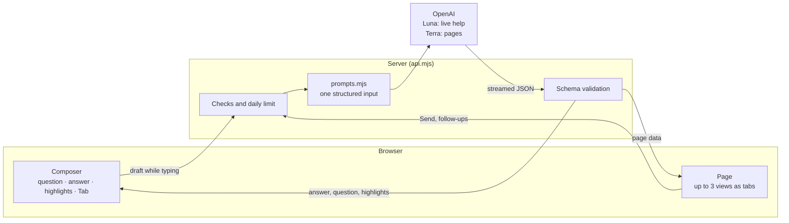

# AI Interaction

Work with AI while a thought is still taking shape. As you type, a fast model answers briefly, asks one useful question, highlights details you can adjust and predicts your next words. On Send, a stronger model turns the request into an interactive page.

## Run it

Requires Node 22 or later; the app has no dependencies.

```sh
cp .env.example .env    # add OPENAI_API_KEY; without it the app runs in demo mode
npm run dev             # http://127.0.0.1:4317
```

Each visitor gets `DAILY_LIMIT` requests per day (default 200) and the whole app `DAILY_TOTAL_LIMIT` (default 2,000); then a "Try again tomorrow" card appears. Counts live in server memory and reset on restart.

## How it works



| Moment | Model | What happens |
| --- | --- | --- |
| While typing | `gpt-6-luna` | One request after every four words or a short pause. Answer, question, Tab prediction and highlights appear as each is written |
| On Send | `gpt-6.1-terra` | Title and introduction appear first, then the main view |
| Right after | `gpt-6-luna` | Up to two more views join as tabs in the background |
| Inside the page | `gpt-6-luna` | Explanations of highlighted text, suggested edits, Go deeper answers |

The model returns data that must pass a strict schema, never HTML or code. The app draws it with its own 24 page components (maps, timelines, charts, quizzes and more) and 24 picker types for the highlighted details.

## Test

```sh
npm ci                                            # installs Playwright
npm test                                          # unit and API tests
PLAYWRIGHT_CHANNEL=chrome npm run test:browser    # browser tests at desktop and phone width
```

Live evaluations (`npm run eval:*`, in `dev/`) need the app running with a key.

## Privacy

- The API key stays on the server. Requests use `store:false`.
- The page loads nothing from outside services, including its font (DM Sans, self-hosted with its license).
- Nothing is saved: pages and history live in the browser tab until reload. Export saves a page as JSON.

The inline-clarification idea builds on [Bruce Liu’s Beyond Taking Turns](https://demos.liubruce.me/intra-turn/).
